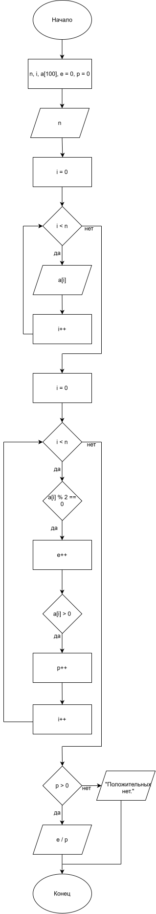

# Домашнее задание к работе 11

## Условие задачи
С одномерным массивом, состоящим из n вводимых с клавиатуры положительных и отрицательных целых чисел выполнить следующие вычисления: Отношение количества четных значений элементов массива к числу
положительных.
## 1. Алгоритм и блок-схема

### Алгоритм
1. **Начало**
2. Объявление переменных:

   `n` - Размер массива,
   
   `i` - Счетчик цикла,

   `a[100]` - массив,

   `e` = 0 - счетчик четных,

   `p` = 0 - счетчик положительных.
3. Ввод числа n с клавиатуры.
4. Ввод элементов массива.
5. Цикл `for` для подсчета четных и целых чисел.
6. Вывод результата.
7. **Конец**

### Блок-схема
 


## 2. Реализация программы
```c
#include <stdio.h>
#include <locale.h>
int main() {
    setlocale(LC_ALL, "RUS");
    int n, i;
    int a[100];
    double e = 0; //Четные
    double p = 0; //Положительные
    printf("Введите количество элементов: ");
    scanf("%d", &n);
    printf("Введите элементы:\n");
    for (i = 0; i < n; i++) {
        scanf("%d", &a[i]);
    }
    for (i = 0; i < n; i++) {
        if (a[i] % 2 == 0) {
            e++;
        }
        if (a[i] > 0) {
            p++;
        }
    }
    printf("Четных: %.0f\n", e);
    printf("Положительных: %.0f\n", p);

    if (p > 0) {
        printf("Отношение: %.2f\n", e / p);
    }
    else {
        printf("Положительных нет.\n");
    }
    return 0;
}
```
## 3. Результаты работы программы
 Введите количество элементов: 7
 
Введите элементы:

-2

-4

1

3

5

7

-3

Четных: 2

Положительных: 4

Отношение: 0,50
## 4. Информация о разработчике

Семочкин Михаил бИЦТ-261
